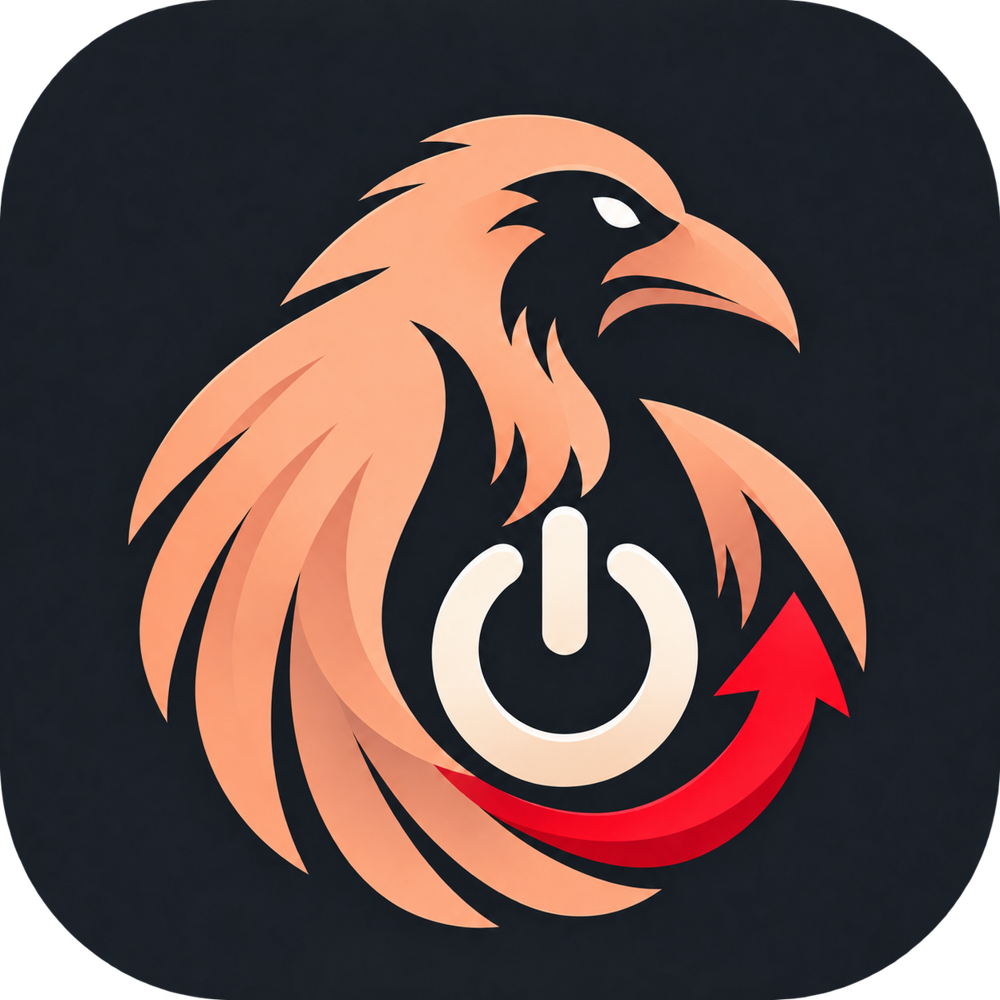

<p align="center"></p>

# Raven App Control

An Android app for AYN devices that uses the factory root service to disable and re-enable apps while preserving their data, with search, system-app filtering, and protection for essential components.

[Download 1.1.1](https://github.com/Rsotbiemrptson/Raven-App-Control/releases/download/v1.1.1/Raven-App-Control-1.1.1.apk) · [Latest release](https://github.com/Rsotbiemrptson/Raven-App-Control/releases/latest)

## Features

- Switch apps off until you choose to enable them again.
- Search by app name or package; browse All apps, Enabled and Disabled.
- Show or hide system apps from the three-dot menu.
- Protect Raven itself, essential Android components, the current launcher, enabled keyboards and active device administrators.
- Raven Backup-style sidebar and app cards, with red accents and matching icon proportions.
- Works offline without ads, analytics, internet permission or a background monitoring service.

## Compatibility

Tested on **AYN Odin 2 running Android 13**, in the device owner's profile. Requires the working AYN factory `PServerBinder` root service. Other models and firmware require hardware compatibility testing. It does not root a device or install a root manager. A generic `su` backend is not included.

Android 11/API 30 or later is required to install. Meeting that Android version alone does not establish factory-root compatibility.

## Install and use

1. Download the APK from [Releases](https://github.com/Rsotbiemrptson/Raven-App-Control/releases).
2. Open it on your device and allow installation from your chosen file manager if Android asks.
3. Open Raven App Control and wait for **AYN root connected**.
4. Turn an app's switch off to disable it. Open **Disabled** and turn the switch on to restore it.

Disabled apps retain their installed files and data. Android keeps the disabled state across restarts; Raven does not need to stay running. The Show system apps setting applies to every list, including Disabled.

**Re-enable apps before uninstalling Raven.** Uninstalling the controller does not undo Android's disabled-app settings. Android's App info screen may offer Enable; an authorized ADB connection can also restore a package with `adb shell pm enable --user 0 PACKAGE`.

Disabling a system app can affect features that depend on it. Protected-app rules are conservative, not a complete dependency map for every firmware. Raven asks before disabling other system apps and verifies the resulting state with Android.

## Verify the download

Compare the APK's SHA-256 with the release's `SHA256SUMS.txt`:

```powershell
Get-FileHash .\Raven-App-Control-1.1.1.apk -Algorithm SHA256
```

Version 1.1.1 SHA-256:

```text
80af33562a99a8be64b98d49cd961563493fb9e7f4923ad384c1724305e7ce23
```

Release signing-certificate SHA-256:

```text
05ffc7ff791cc573abd83a9d35fef0f2b0f4559b5897ea934af92414fad41046
```

## Source and builds

The repository includes the app's Java source, resources, manifest, portable Windows build script and device-test sources. No private signing material is included. Local builds use a separate development key and cannot replace the published APK without uninstalling it first.

See [Building](docs/BUILD.md), [Testing](docs/TESTING.md) and [Architecture](docs/ARCHITECTURE.md).

## Version 1.1.1

Matches Raven Backup's icon display method and corner transparency, while retaining the power symbol and red feather. The icon update passed 31 targeted live checks on Odin 2. See [Changelog](CHANGELOG.md).
